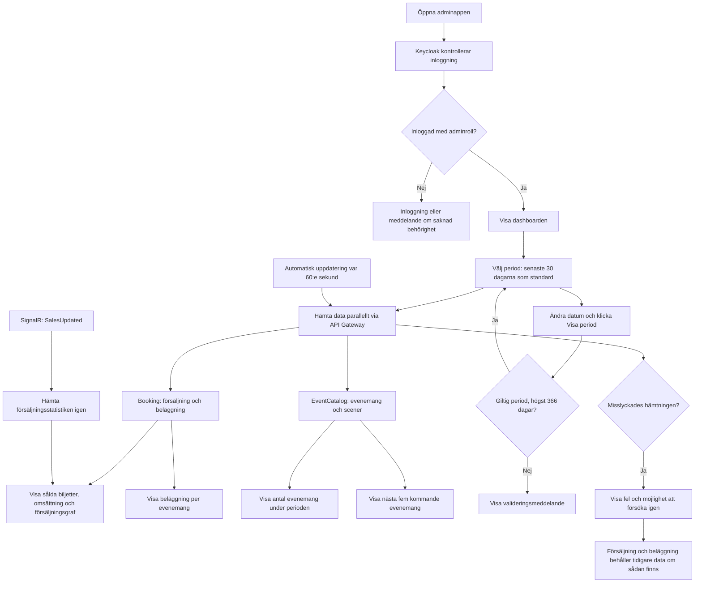

# Admin-dashboarden

Admin-dashboarden i Hälsinge Live ger administratören en överblick över biljettförsäljning, omsättning, beläggning och evenemang. Dokumentet beskriver den befintliga implementationen.

## Flödesschema



Schemat visar huvudflödet. Minutuppdateringen gäller försäljning, beläggning, antal evenemang och kommande evenemang. Scenlistan hämtas separat och har ingen egen minutuppdatering. Byte av statistikperiod påverkar inte listan med kommande evenemang.

## Så fungerar dashboarden

### 1. Inloggning och behörighet

När adminappen öppnas startar en inloggningskontroll via Keycloak. Användaren behöver logga in och ha rollen `admin` för att gränssnittet ska visas. Saknas rollen visas ett meddelande om att administratörsbehörighet saknas.

API-anrop skickar med en åtkomsttoken i HTTP-headern `Authorization: Bearer ...`. Innan anropet försöker appen förnya token om den snart går ut. Statistikens API-endpoints kräver också administratörsbehörighet genom policyn `AdminOnly`.

Det innebär att behörigheten kontrolleras både i gränssnittet och i backend. Att dölja en sida räcker inte som skydd, eftersom ett API också kan anropas direkt.

### 2. Välj period

Dashboarden visar som standard de senaste 30 kalenderdagarna, inklusive idag. Administratören kan ändra från- och tilldatum och klicka på **Visa period**, eller återgå med **Senaste 30 dagarna**.

Perioden måste innehålla giltiga datum, från-datum får inte ligga efter till-datum och intervallet får vara högst 366 dagar. Vid ett ogiltigt val visas ett meddelande och knappen för att tillämpa perioden är inaktiverad.

Den valda perioden styr:

- Sålda biljetter och omsättning.
- Försäljningsgrafen.
- Antal evenemang.
- Beläggning per evenemang.

Datum tolkas enligt `Europe/Stockholm`. Båda valda kalenderdagarna ingår. Gränserna beräknas med hänsyn till sommar- och vintertid, eftersom ett svenskt kalenderdygn kan vara 23 eller 25 timmar.

### 3. Hämta data

Dashboarden hämtar sina delar med separata anrop via API Gateway. Gatewayen skickar anropen vidare till rätt tjänst.

| Information | Ansvarig tjänst | Användning |
| --- | --- | --- |
| Försäljningsstatistik | Booking, med betalningsdata från betalningstjänsten | Biljettantal, omsättning, jämförelse och daglig försäljning |
| Beläggning | Booking, med evenemangsdata från EventCatalog | Kapacitet och sålda platser per evenemang |
| Evenemang | EventCatalog | Antal under perioden och kommande evenemang |
| Scener | EventCatalog | Scennamn i listan med kommande evenemang |

Frontend använder TanStack Query för att hantera hämtning, cache, laddningsstatus och fel. Statistikens cache-nycklar innehåller perioden, så att data från olika datumintervall hålls isär.

### 4. Visa försäljning och omsättning

Backend kopplar ihop bekräftade bokningar med lyckade betalningar och kontrollerar bland annat att belopp och valuta stämmer. Försäljningen grupperas efter betalningsdatum i svensk tid.

- **Sålda biljetter** visar biljetter i de matchande bokningarna som inte har återbetalats.
- **Omsättning** visar nettoomsättning: betalningar minus återbetalningar.
- **Biljettförsäljning** visar försäljningen fördelad per dag.
- **Förändring i procent** jämför med den direkt föregående, lika långa perioden. Om föregående värde är noll returneras ingen procentsats, eftersom beräkningen då skulle kräva division med noll.

En full återbetalning hänförs till den ursprungliga försäljningsdagen. Historiska försäljningssiffror kan därför ändras efter en återbetalning.

### 5. Visa beläggning per evenemang

Beläggningsdiagrammet visar en stapel per evenemang med biljettkapacitet inom den valda perioden. Perioden avser här evenemangets startdatum i svensk tid.

Beräkningen bygger på biljettlagret:

```text
Sålda platser = total kapacitet − tillgängliga platser
Beläggning i procent = sålda platser / kapacitet × 100
```

Evenemangen sorteras från högst till lägst beläggning. Diagrammet visar namn, datum och tid. När administratören pekar på en stapel visas även antal sålda platser, kapacitet och scen.

Evenemangets ID används för att skilja staplarna åt. Två evenemang med samma namn visas därför som separata evenemang.

### 6. Visa antal och kommande evenemang

Kortet **Evenemang** visar det totala antalet evenemang som startar inom den valda perioden. För att få antalet begär frontend bara en resultatrad och använder svarets `totalCount`, vilket begränsar mängden överförd data.

Tabellen **Kommande evenemang** visar nästa fem evenemang räknat från aktuell tid. Den påverkas inte av statistikperioden. Administratören kan klicka på ett evenemang för att öppna dess administrationssida eller välja **Visa alla** för att gå till evenemangslistan.

## Uppdateringar och felhantering

Försäljningsstatistiken har en SignalR-anslutning. När backend skickar händelsen `SalesUpdated` markerar frontend den sparade försäljningsstatistiken som inaktuell och hämtar den aktiva statistiken igen. Även när anslutningen upprättas eller återansluts begärs en uppdatering.

Försäljning, beläggning, antal evenemang och kommande evenemang har dessutom automatisk uppdatering var 60:e sekund. Det ger återkommande uppdateringar även om en signal inte når fram. Beläggningen har ingen direkt uppdatering kopplad till `SalesUpdated`.

Under den första hämtningen visas laddningsindikatorer. Om försäljning eller beläggning redan har hämtats för perioden och nästa hämtning misslyckas, behålls de senaste värdena tillsammans med en varning. Administratören kan använda **Försök igen** för en manuell hämtning. Utan tidigare data visas ett felmeddelande.

För försäljning och beläggning görs ett automatiskt nytt försök vid vissa fel. Ogiltiga förfrågningar och behörighetsfel (`400`, `401`, `403`) försöks inte automatiskt igen av dessa queries.

## Frontendens komponenter och kontroll

`DashboardPage` äger den tillämpade perioden och skickar den som props till
`SalesStatisticsSection` och `OccupancySection`. `DashboardPeriodFilter` håller
ett separat utkast som tillämpas först när administratören använder någon av
periodknapparna. Filtret monteras om med de tillämpade datumen när perioden ändras.
Försäljning, beläggning och periodens evenemangsantal skickar en avbrottssignal
med anropen, så att inaktuella hämtningar kan avbrytas.

`SalesMetricCard` formaterar värden, procentuell förändring och jämförelseperiod.
`TicketSalesChart` använder MUI X Charts `LineChart`, som laddas vid behov.
Grafen använder administratörstemat och har en tillgänglig sammanfattning,
en punkt och vertikal rutnätslinje per dag. Axelns datumetiketter visas var femte
dag med svensk månad, till exempel `5 sep`. Verktygstips visar fullständigt datum
och biljettantal. Längre perioder kan rullas i sidled.

SignalR-klienten försöker återansluta när anslutningen bryts. Misslyckade första
anslutningsförsök försöks igen efter fem sekunder.

Frontendkontroller körs från `src/frontend/admin-web`:

```sh
npm run lint
npm run build
node --experimental-strip-types --test tests/dashboardPeriod.test.mjs
```

Datumtesterna täcker standardperioden i svensk tid, ogiltiga intervall,
maximal period och båda tidsomställningarna. Kontroll med simulerade API-svar
ersätter inte verifiering av hela flödet med autentisering och backend.

## Varför dashboarden är uppbyggd så

| Lösning | Syfte |
| --- | --- |
| Central inloggning med Keycloak | Samlar inloggning och roller på ett ställe. |
| Behörighetskontroll i backend | Skyddar uppgifterna även vid direkta API-anrop. |
| Gemensam statistikperiod | Gör att administratören kan undersöka samma kalenderintervall i flera vyer. |
| Separata datahämtningar | Låter delarna laddas oberoende och begränsar hur ett enskilt fel påverkar sidan. |
| TanStack Query och cache per period | Hanterar sparade svar och uppdateringar utan att blanda olika perioder. |
| Beräkningar i backend | Håller affärsregler och kontroll av boknings- och betalningsdata i tjänsterna som äger informationen. |
| SignalR och minutuppdatering | Kombinerar snabb uppdatering av försäljning med återkommande hämtning. |
| Tidigare värden visas vid uppdateringsfel | Gör sidan fortsatt användbar samtidigt som administratören ser att uppdateringen misslyckades. |
| Svensk tidszon | Gör att datumen följer verksamhetens kalenderdagar även runt midnatt och tidsomställningar. |

## Så ska siffrorna tolkas

Försäljning och beläggning använder olika datum och underlag:

| Mått | Datum som styr urvalet | Underlag |
| --- | --- | --- |
| Försäljning och omsättning | Betalningsdatum | Bekräftade bokningar och lyckade betalningar, med hänsyn till återbetalningar |
| Beläggning | Evenemangets startdatum | Biljettlagrets kapacitet och tillgängliga platser |
| Antal evenemang | Evenemangets startdatum | Evenemangskatalogen |
| Kommande evenemang | Aktuell tid | Nästa fem evenemang i katalogen |

Exempel: En biljett betalas i november till en konsert i december. Betalningen ingår i novembers försäljning. Konsertens beläggning visas när den valda perioden omfattar konsertens startdatum i december. Försäljningssiffran och beläggningen behöver därför inte motsvara varandra för en viss period.

## Beläggningens API och backendfiltrering

Booking har två endpoints som kräver administratörsbehörighet och tar valfria
`from`- och `to`-datum:

- `/GetEventOccupancy` returnerar `eventId`, `eventName`, `eventStartsAt`,
  `venueId`, `venueName`, `capacity`, `sold` och `occupancyPercent`.
- `/GetVenueOccupancy` returnerar `venueId`, `venueName`, `capacity`, `sold`
  och `occupancyPercent`. Beläggningen per scen beräknas från summerade sålda
  platser och summerad kapacitet, inte som medelvärdet av evenemangens procentsatser.

Booking hämtar kataloguppgifter för biljettlagrets evenemangs-ID:n i grupper om
500. Katalogens inkluderande UTC-dagsfilter begränsar urvalet till dagar som berör
det svenska intervallet. Booking filtrerar sedan exakt på svenska kalenderdatum.
Det begränsar mängden hämtad historik och hanterar midnatt samt sommar- och
vintertid. Raderade evenemang utesluts. Antalet sålda platser beräknas som total
kvantitet minus tillgänglig kvantitet.

Backendtesterna omfattar separata rader för evenemang med samma namn och svenska
datumgränser på dagen för övergång till vintertid. Det finns även tester för
scensummor, raderade evenemang, avbrutna anrop och timeout.

### Utvecklingsmiljö och integrationshistorik

Adminens utvecklingscontainer kör `npm ci` innan Vite startas. Det uppdaterar den
beständiga volymen `/app/node_modules` från låsfilen vid varje start, så att nya
beroenden, exempelvis `@mui/x-charts`, installeras efter ett grenbyte.

Beläggningsgrenen integrerades selektivt. Dess versionshanterade `env`-fil togs
inte med, befintliga lokala ändringar behölls och ingen merge-commit skapades.
`env` och `.env` ignoreras av Git. Konfigurera `.env` i projektroten separat från
Git och generera en lokal intern API-nyckel. En tidigare incheckad nyckel finns
fortfarande i källgrenens historik och behöver roteras där den används; att
utesluta filen återkallar inte nyckeln.

## Kodreferenser

- [Appstart och behörighetskontroll](../src/frontend/admin-web/src/main.tsx)
- [Dashboardens huvudsida](../src/frontend/admin-web/src/features/dashboard/pages/DashboardPage.tsx)
- [Periodfilter](../src/frontend/admin-web/src/features/dashboard/components/DashboardPeriodFilter.tsx)
- [Datumhantering och validering](../src/frontend/admin-web/src/features/dashboard/utils/dashboardPeriod.ts)
- [Försäljning och SignalR](../src/frontend/admin-web/src/features/dashboard/components/SalesStatisticsSection.tsx)
- [Beläggningsdiagram](../src/frontend/admin-web/src/features/dashboard/components/OccupancySection.tsx)
- [Autentiserade API-anrop](../src/frontend/admin-web/src/shared/api/http.ts)
- [Beräkning av försäljningsstatistik](../src/services/Booking/features/statistics/SalesStatistics.cs)
- [API för beläggning](../src/services/Booking/features/bookings/EventOccupancyController.cs)
- [Backendrapport för beläggning och datumfiltrering](../src/services/Booking/features/bookings/VenueOccupancyReport.cs)
- [Tester för beläggning](../tests/Booking.UnitTests/VenueOccupancyTests.cs)
- [Försäljningsstatistikens API och backendregler](sales-statistics.md)
