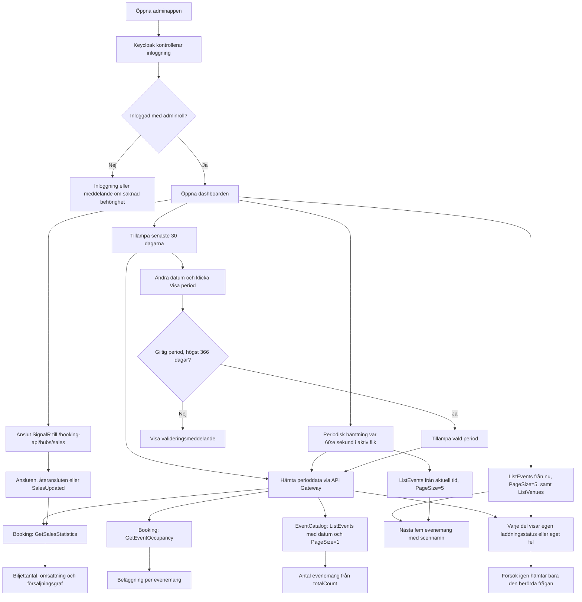

# Admin-dashboarden

Admin-dashboarden i Hälsinge Live ger administratören en överblick över biljettförsäljning, omsättning, beläggning och evenemang. Dokumentet beskriver startsidan `/dashboard`: dess API-anrop, periodfilter, presentation, uppdateringar och felhantering. Evenemangsredigering, bokningshantering, entréskanner och utvecklingsverktyg i den gemensamma sidomenyn är separata adminfunktioner.

## Flödesschema



Periodbyte påverkar försäljning, beläggning och antal evenemang. Kommande evenemang
utgår alltid från aktuell tid. Scenlistan hämtas separat och har ingen egen
minutuppdatering. Försäljning och beläggning kan behålla tidigare värden för samma
period om en uppdatering misslyckas. Detaljerna beskrivs i tabellerna nedan.

## Så fungerar dashboarden

### 1. Inloggning och behörighet

När adminappen öppnas startar en inloggningskontroll via Keycloak. Användaren behöver logga in och ha rollen `admin` för att gränssnittet ska visas. Saknas rollen visas ett meddelande om att administratörsbehörighet saknas.

API-anrop skickar med en åtkomsttoken i HTTP-headern `Authorization: Bearer ...`. Innan anropet försöker appen förnya token om den snart går ut. Statistikens API-endpoints kräver också administratörsbehörighet genom policyn `AdminOnly`.

Det innebär att behörigheten kontrolleras både i gränssnittet och i backend. Att dölja en sida räcker inte som skydd, eftersom ett API också kan anropas direkt.

### 2. Välj period

Dashboarden visar som standard de senaste 30 kalenderdagarna, inklusive idag. Administratören kan ändra från- och tilldatum och klicka på **Visa period**, eller återgå med **Senaste 30 dagarna**.

Perioden måste innehålla giltiga datum, från-datum får inte ligga efter till-datum och intervallet får vara högst 366 dagar. Vid ett ogiltigt val visas ett meddelande och knappen för att tillämpa perioden är inaktiverad.

Den valda perioden styr:

- Sålda biljetter och omsättning.
- Försäljningsgrafen.
- Antal evenemang.
- Beläggning per evenemang.

Datum tolkas enligt `Europe/Stockholm`. Båda valda kalenderdagarna ingår. Gränserna beräknas med hänsyn till sommar- och vintertid, eftersom ett svenskt kalenderdygn kan vara 23 eller 25 timmar.

### 3. Hämta data

Dashboarden använder fem separata datafrågor: försäljning, beläggning, periodens
evenemangsantal, kommande evenemang och scener. Två av frågorna använder samma
endpoint, `ListEvents`, med olika parametrar. Det är alltså fyra olika
JSON-endpoints. Frågorna kan hämtas oberoende och ett fel stoppar inte övriga delar.

Tabellen visar GET-anropen med projektets vanliga API-prefix. Katalogprefixet
`/api` kan ersättas genom frontendinställningen `VITE_CATALOG_API_URL`.

| Del i gränssnittet | Frontendfunktion | Anrop via gatewayen | Parametrar och användning av svaret |
| --- | --- | --- | --- |
| Sålda biljetter, omsättning och försäljningsgraf | `getSalesStatistics(period, signal)` | `/booking-api/GetSalesStatistics` → Booking | `from` och `to` som svenska kalenderdatum (`YYYY-MM-DD`). `summary` ger biljettantal och nettoomsättning, `previousPeriod` och `changes` ger jämförelsen, `daily` ger grafens värden. |
| Beläggning per evenemang | `getEventOccupancy(from, to, signal)` | `/booking-api/GetEventOccupancy` → Booking | Samma `from` och `to`. Varje rad innehåller bland annat evenemangets ID, namn, starttid, scen, kapacitet, sålda platser och beläggning i procent. |
| Kortet Evenemang | `getEvents({ ...eventPeriodBounds(period), pageSize: 1 }, signal)` | `/api/ListEvents` → EventCatalog | `StartAfter` och `StartsBefore` är UTC-gränser för den valda svenska perioden. `Page=1` och `PageSize=1`. Kortet läser `totalCount`, inte längden på den returnerade listan. |
| Tabellen Kommande evenemang | `getEvents({ startAfter: new Date().toISOString(), pageSize: 5 })` | `/api/ListEvents` → EventCatalog | `StartAfter` beräknas från aktuell tid vid varje hämtning, med `Page=1` och `PageSize=5`. Svarets `events` används för namn, bild, datum och länkar. |
| Scennamn i samma tabell | `getVenues()` | `/api/ListVenues` → EventCatalog | Inga frågeparametrar. Scenernas ID:n matchas mot varje evenemangs `venueId` för att visa namnet. |

`eventPeriodBounds` omvandlar periodens början till svensk midnatt uttryckt i UTC
och slutet till sista millisekunden före nästa svenska kalenderdag.
Försäljning och beläggning skickar i stället kalenderdatumen direkt till Booking,
som ansvarar för tolkningen i backend.

Alla fem JSON-frågor använder den gemensamma HTTP-hjälparen som förnyar token vid
behov och skickar `Authorization: Bearer ...`. Vite i utvecklingsläge eller Nginx
för den byggda appen skickar vidare anropet till API Gateway. Gatewayen väljer
tjänst och tar bort prefixet, exempelvis
`/booking-api/GetEventOccupancy` → Booking `/GetEventOccupancy`.
Booking hämtar i sin tur betalningsdata för försäljningen och katalogdata för
beläggningsrapporten. Dashboarden anropar inte PaymentSimulator direkt för statistiken.

**`GetVenueOccupancy` används inte av dashboarden.** Endpointen finns i Booking
för en rapport per scen. Dashboarden använder `GetEventOccupancy` för att visa
varje evenemang separat. Backendkontrakten beskrivs längre ned i dokumentet.

Utöver JSON-anropen kan webbläsaren hämta evenemangsbilder från `imageUrl` i
evenemangssvaret. För uppladdade katalogbilder leder adressen normalt till
`/api/DownloadEventImage/{eventId}/{imageId}`. Bilderna laddas med `loading="lazy"`
i tabellen och går inte genom TanStack Query eller den autentiserade HTTP-hjälparen.
Om en bild inte går att ladda döljs den. Keycloaks inloggnings- och tokenanrop
hanteras separat av autentiseringsbiblioteket.

Frontend använder TanStack Query för hämtning, cache, laddningsstatus och fel.
Försäljning, beläggning och periodens evenemangsantal har båda datumen i sina
cache-nycklar. Kommande evenemang har en separat nyckel utan perioden och scenerna
använder den gemensamma nyckeln `['venues']`.

### 4. Visa försäljning och omsättning

Backend kopplar ihop bekräftade bokningar med lyckade betalningar och kontrollerar bland annat att belopp och valuta stämmer. Försäljningen grupperas efter betalningsdatum i svensk tid.

- **Sålda biljetter** visar biljetter i de matchande bokningarna som inte har återbetalats.
- **Omsättning** visar nettoomsättning: betalningar minus återbetalningar.
- **Biljettförsäljning** visar försäljningen fördelad per dag.
- **Förändring i procent** jämför med den direkt föregående, lika långa perioden. Om föregående värde är noll returneras ingen procentsats, eftersom beräkningen då skulle kräva division med noll.

En full återbetalning hänförs till den ursprungliga försäljningsdagen. Historiska försäljningssiffror kan därför ändras efter en återbetalning.

### 5. Visa beläggning per evenemang

Beläggningsdiagrammet visar en stapel per evenemang med biljettkapacitet inom den valda perioden. Perioden avser här evenemangets startdatum i svensk tid.

Beräkningen bygger på biljettlagret:

```text
Sålda platser = total kapacitet − tillgängliga platser
Beläggning i procent = sålda platser / kapacitet × 100
```

Evenemangen sorteras från högst till lägst beläggning. Diagrammet visar namn, datum och tid. När administratören pekar på en stapel visas även antal sålda platser, kapacitet och scen.

Evenemangets ID används för att skilja staplarna åt. Två evenemang med samma namn visas därför som separata evenemang.

### 6. Visa antal och kommande evenemang

Kortet **Evenemang** visar det totala antalet evenemang som startar inom den valda perioden. För att få antalet begär frontend bara en resultatrad och använder svarets `totalCount`, vilket begränsar mängden överförd data.

Tabellen **Kommande evenemang** visar nästa fem evenemang räknat från aktuell tid. Den påverkas inte av statistikperioden. Administratören kan klicka på ett evenemang för att öppna dess administrationssida eller välja **Visa alla** för att gå till evenemangslistan.

## Uppdateringar och felhantering

### När hämtas uppgifterna?

| Händelse | Försäljning | Beläggning | Antal evenemang | Kommande evenemang | Scennamn |
| --- | --- | --- | --- | --- | --- |
| Dashboarden öppnas | Frågan aktiveras | Frågan aktiveras | Frågan aktiveras | Frågan aktiveras | Frågan aktiveras; kan dela cache med andra adminsidor |
| En annan period tillämpas | Cache-nyckeln ändras | Cache-nyckeln ändras | Cache-nyckeln ändras | Påverkas inte av periodbytet | Påverkas inte av periodbytet |
| Var 60:e sekund i en aktiv flik | Hämtas igen | Hämtas igen | Hämtas igen | Hämtas igen med ny aktuell tid | Inget eget intervall |
| SignalR ansluter, återansluter eller skickar `SalesUpdated` | Markeras inaktuell och den aktiva frågan hämtas igen | Ingen direkt effekt | Ingen direkt effekt | Ingen direkt effekt | Ingen direkt effekt |
| Försök igen | Hämtar försäljningen | Hämtar beläggningen | Hämtar antalet | Hämtar kommande evenemang | Hämtar scenerna |

När en fråga aktiveras används dess cache om den finns. Om data saknas hämtas den;
om den är inaktuell kan den visas medan en ny hämtning sker. Försäljning och
beläggning har `staleTime: 60_000`, vilket gör svaret aktuellt i en minut.
Evenemangsfrågorna och scenerna använder TanStack Querys standardvärde, där data
blir inaktuell direkt. Appens `QueryClient` ändrar inte standardinställningarna.
Inaktuella aktiva frågor kan därför också hämtas vid återanslutning till nätverket
eller när fönstret återfår fokus. Intervallhämtning i bakgrundsflikar är inte
aktiverad. Den valda perioden ligger kvar som kalenderdatum tills administratören
ändrar den; minutuppdateringen flyttar inte automatiskt fram perioden vid midnatt.

### SignalR meddelar att försäljningen behöver hämtas igen

`SalesStatisticsSection` öppnar en autentiserad SignalR-anslutning till
`/booking-api/hubs/sales`. Gatewayen skickar den till Bookings `/hubs/sales`.
SignalR sköter anslutningsförhandlingen och transporten; anslutningen är separat
från statistikens vanliga GET-anrop.

Händelsen `SalesUpdated` innehåller inga statistikvärden. Frontend markerar
frågorna med nyckelprefixet `['sales-statistics']` som inaktuella och hämtar den
aktiva periodens statistik från `GetSalesStatistics`. Samma uppdatering begärs
när anslutningen först upprättas och när den återansluts. Pågående hämtningar och
nya signaler samordnas med en köad uppdatering. Periodbyte kräver ingen ny
SignalR-anslutning, eftersom den inte är kopplad till en viss period.

Klienten försöker återansluta automatiskt vid avbrott. Om starten misslyckas,
eller anslutningen stängs efter återanslutningsförsöken, planeras ett nytt
anslutningsförsök efter fem sekunder. När komponenten lämnas tas händelselyssnaren
och återförsökstimern bort och anslutningen stoppas. Ett SignalR-fel loggas i
webbläsarkonsolen; det visas ingen separat anslutningsvarning i dashboarden.
Försäljningens minutuppdatering fortsätter att ge återkommande GET-hämtningar.

### Laddning, tomma svar och fel per del

| Del | Första hämtning utan cache | Tomt eller nollställt resultat | Misslyckad hämtning |
| --- | --- | --- | --- |
| Försäljning | Laddningsplatshållare i kort och graf | Nollvärden visas från svaret; dagar ingår även utan försäljning | Utan tidigare data visas fel och grafens informationstext. Med data för samma period visas tidigare värden och en varning. Vid 401/403 uppmanas användaren att logga in igen. |
| Beläggning | Laddningsindikator; separat indikator medan diagrambiblioteket laddas | Meddelande om att inga evenemang med biljettkapacitet hittades under perioden | Utan tidigare data visas fel. Med data för samma period behålls diagrammet eller tomläget tillsammans med en varning. |
| Antal evenemang | Laddningsindikator | `0` visas | Felmeddelandet ersätter antalet, även om frågan har äldre cachedata. |
| Kommande evenemang | Laddningsindikator | Meddelande om att det inte finns några kommande evenemang | Felmeddelandet ersätter tabellen, även om frågan har äldre cachedata. |
| Scennamn | `Hämtar scen…` i tabellens scenkolumn | `Scen saknas` om ID:t inte finns i scenlistan | Evenemangstabellen fungerar fortfarande. Om det finns evenemang att visa visas en varning med Försök igen. Äldre cachade scennamn kan användas; annars visas Scen saknas. |

Varje fels egen **Försök igen**-knapp anropar just den berörda frågans `refetch`.
Ett byte till en helt ny period visar laddningsläget om det saknas cache för den
perioden. Data från den föregående perioden används inte som platshållare.
Vid en pågående bakgrundshämtning av försäljningen visas texten **Uppdaterar…**.

För försäljning och beläggning görs högst ett automatiskt nytt försök vid andra
fel än `400`, `401` och `403`. Evenemangs- och scenfrågorna använder standarden
för klientfrågor, med upp till tre automatiska nya försök. HTTP-hjälparen
omvandlar misslyckade HTTP-svar till `ApiError`. Om tokenförnyelsen misslyckas
rensas tokenen och ett 401-fel skapas innan API-anropet skickas.

## Frontendens komponenter och kontroll

`DashboardPage` äger den tillämpade perioden och skickar den som props till
`SalesStatisticsSection` och `OccupancySection`. `DashboardPeriodFilter` håller
ett separat utkast som tillämpas först när administratören använder någon av
periodknapparna. Filtret monteras om med de tillämpade datumen när perioden ändras.
Försäljning, beläggning och periodens evenemangsantal skickar en avbrottssignal
med anropen, så att inaktuella hämtningar kan avbrytas.

`SalesMetricCard` formaterar värden, procentuell förändring och jämförelseperiod.
`TicketSalesChart` använder MUI X Charts `LineChart`, som laddas vid behov.
Grafen använder administratörstemat och har en tillgänglig sammanfattning,
en punkt och vertikal rutnätslinje per dag. Axelns datumetiketter visas var femte
dag med svensk månad, till exempel `5 sep`. Verktygstips visar fullständigt datum
och biljettantal. Längre perioder kan rullas i sidled.

Frontendkontroller körs från `src/frontend/admin-web`:

```sh
npm run lint
npm run build
node --experimental-strip-types --test tests/dashboardPeriod.test.mjs
```

Datumtesterna täcker standardperioden i svensk tid, ogiltiga intervall,
maximal period och båda tidsomställningarna. Kontroll med simulerade API-svar
ersätter inte verifiering av hela flödet med autentisering och backend.

## Varför dashboarden är uppbyggd så

| Lösning | Syfte |
| --- | --- |
| Central inloggning med Keycloak | Samlar inloggning och roller på ett ställe. |
| Behörighetskontroll i backend | Skyddar uppgifterna även vid direkta API-anrop. |
| Gemensam statistikperiod | Gör att administratören kan undersöka samma kalenderintervall i flera vyer. |
| Separata datahämtningar | Låter delarna laddas oberoende och begränsar hur ett enskilt fel påverkar sidan. |
| TanStack Query och cache per period | Hanterar sparade svar och uppdateringar utan att blanda olika perioder. |
| Beräkningar i backend | Håller affärsregler och kontroll av boknings- och betalningsdata i tjänsterna som äger informationen. |
| SignalR och minutuppdatering | Kombinerar snabb uppdatering av försäljning med återkommande hämtning. |
| Tidigare värden visas vid uppdateringsfel | Gör sidan fortsatt användbar samtidigt som administratören ser att uppdateringen misslyckades. |
| Svensk tidszon | Gör att datumen följer verksamhetens kalenderdagar även runt midnatt och tidsomställningar. |

## Så ska siffrorna tolkas

Försäljning och beläggning använder olika datum och underlag:

| Mått | Datum som styr urvalet | Underlag |
| --- | --- | --- |
| Försäljning och omsättning | Betalningsdatum | Bekräftade bokningar och lyckade betalningar, med hänsyn till återbetalningar |
| Beläggning | Evenemangets startdatum | Biljettlagrets kapacitet och tillgängliga platser |
| Antal evenemang | Evenemangets startdatum | Evenemangskatalogen |
| Kommande evenemang | Aktuell tid | Nästa fem evenemang i katalogen |

Exempel: En biljett betalas i november till en konsert i december. Betalningen ingår i novembers försäljning. Konsertens beläggning visas när den valda perioden omfattar konsertens startdatum i december. Försäljningssiffran och beläggningen behöver därför inte motsvara varandra för en viss period.

## Beläggningens API och backendfiltrering

Booking har två endpoints som kräver administratörsbehörighet och tar valfria
`from`- och `to`-datum. Bara den första används av dashboarden:

- `/GetEventOccupancy` returnerar `eventId`, `eventName`, `eventStartsAt`,
  `venueId`, `venueName`, `capacity`, `sold` och `occupancyPercent`.
- `/GetVenueOccupancy` används inte av dashboarden och returnerar `venueId`, `venueName`, `capacity`, `sold`
  och `occupancyPercent`. Beläggningen per scen beräknas från summerade sålda
  platser och summerad kapacitet, inte som medelvärdet av evenemangens procentsatser.

Booking hämtar kataloguppgifter för biljettlagrets evenemangs-ID:n i grupper om
500. Katalogens inkluderande UTC-dagsfilter begränsar urvalet till dagar som berör
det svenska intervallet. Booking filtrerar sedan exakt på svenska kalenderdatum.
Det begränsar mängden hämtad historik och hanterar midnatt samt sommar- och
vintertid. Raderade evenemang utesluts. Antalet sålda platser beräknas som total
kvantitet minus tillgänglig kvantitet.

Backendtesterna omfattar separata rader för evenemang med samma namn och svenska
datumgränser på dagen för övergång till vintertid. Det finns även tester för
scensummor, raderade evenemang, avbrutna anrop och timeout.

### Utvecklingsmiljö och integrationshistorik

Adminens utvecklingscontainer kör `npm ci` innan Vite startas. Det uppdaterar den
beständiga volymen `/app/node_modules` från låsfilen vid varje start, så att nya
beroenden, exempelvis `@mui/x-charts`, installeras efter ett grenbyte.

Beläggningsgrenen integrerades selektivt. Dess versionshanterade `env`-fil togs
inte med, befintliga lokala ändringar behölls och ingen merge-commit skapades.
`env` och `.env` ignoreras av Git. Konfigurera `.env` i projektroten separat från
Git och generera en lokal intern API-nyckel. En tidigare incheckad nyckel finns
fortfarande i källgrenens historik och behöver roteras där den används; att
utesluta filen återkallar inte nyckeln.

## Kodreferenser

- [Appstart och behörighetskontroll](../src/frontend/admin-web/src/main.tsx)
- [Dashboardens huvudsida](../src/frontend/admin-web/src/features/dashboard/pages/DashboardPage.tsx)
- [Periodfilter](../src/frontend/admin-web/src/features/dashboard/components/DashboardPeriodFilter.tsx)
- [Datumhantering och validering](../src/frontend/admin-web/src/features/dashboard/utils/dashboardPeriod.ts)
- [Försäljning och SignalR](../src/frontend/admin-web/src/features/dashboard/components/SalesStatisticsSection.tsx)
- [Beläggningsdiagram](../src/frontend/admin-web/src/features/dashboard/components/OccupancySection.tsx)
- [API-klient för försäljningsstatistik](../src/frontend/admin-web/src/features/dashboard/api/salesStatistics.ts)
- [API-klient för beläggning](../src/frontend/admin-web/src/features/dashboard/api/occupancy.ts)
- [API-klient för evenemang och bildadresser](../src/frontend/admin-web/src/features/events/api/events.ts)
- [API-klient för scener](../src/frontend/admin-web/src/features/venues/api/venues.ts)
- [Gatewayens rutter och prefix](../src/ApiGateway/appsettings.json)
- [SignalR-hubb i Booking](../src/services/Booking/features/statistics/SalesUpdatesHub.cs)
- [Autentiserade API-anrop](../src/frontend/admin-web/src/shared/api/http.ts)
- [Beräkning av försäljningsstatistik](../src/services/Booking/features/statistics/SalesStatistics.cs)
- [API för beläggning](../src/services/Booking/features/bookings/EventOccupancyController.cs)
- [Backendrapport för beläggning och datumfiltrering](../src/services/Booking/features/bookings/VenueOccupancyReport.cs)
- [Tester för beläggning](../tests/Booking.UnitTests/VenueOccupancyTests.cs)
- [Försäljningsstatistikens API och backendregler](sales-statistics.md)
