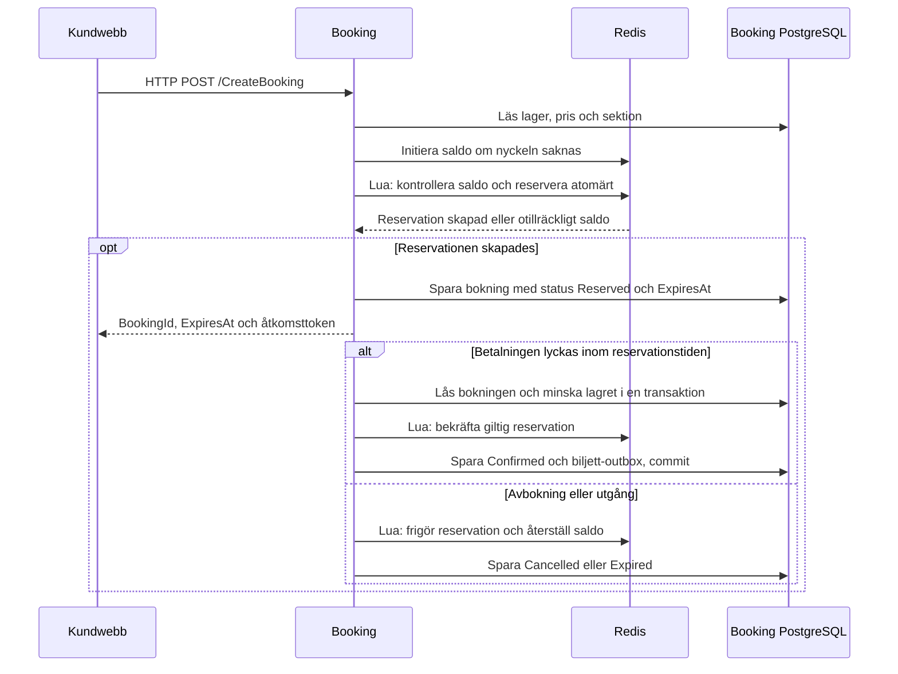

# Redis och reservationsflöden

## Översikt

Redis används i Booking för att hålla reda på tillfälliga reservationer och hur många platser som är tillgängliga i en evenemangssektion. När en kund reserverar biljetter minskas det tillgängliga antalet direkt i Redis. Andra kunder ser då ett saldo där de reserverade platserna redan är avdragna, även om betalningen ännu inte är klar.

Booking fördelar ansvaret mellan två datalager:

- **Redis** hanterar tillgängligt saldo, aktiva reservationer och markörer som gör upprepade anrop säkra.
- **PostgreSQL** sparar bokningar, bokningsrader, priser, betalningsstatus och det beständiga lagersaldot. Databasen gör den slutliga lagerkontrollen när en bokning bekräftas.

En reservation gäller i tio minuter. Om betalningen lyckas och reservationen fortfarande är giltig bekräftas bokningen. Vid avbokning eller utgång frigörs platserna i Redis. Lagerhanteringen gäller antal biljetter per evenemang och sektion; Redis lagrar inga individuella stolsreservationer.



Betalningsbehandling och biljettutfärdande ligger utanför Redis. Redis används inte som meddelandekö, betalningsdatabas eller lås för betalningsflödet. Se även [betalningsflödet](payments.md).

### Vilka flöden använder Redis?

| Flöde | Kod | Nuvarande användning |
| --- | --- | --- |
| Skapa reservation | `CreateReservationAsync` i `BookingService` | Initierar saldo vid behov och reserverar platser före lagring av bokningen. |
| Läsa tillgänglighet | `GetEventInventoryHandler` och `ListEventInventoryHandler` | Hämtar aktuellt Redis-saldo efter att utgångna reservationer har städats. |
| Bekräfta bokning | `ConfirmAsync` i `BookingService` | Slutför reservationen tillsammans med Bookings kontroll av betalning och databaslager. |
| Avboka bokning | `CancelAsync` i `BookingService` | Frigör reservationen och återställer reserverat antal. |
| Hantera utgång | `BookingExpirationService` och reservationernas Lua-skript | Återför platser vars reservationstid har passerat. Bakgrundstjänsten uppdaterar också bokningsstatus. |
| Seed och återställning | Handlers under `features/Seed` | Bygger om eller raderar Redis-lager i samband med ändringar av testdata. |

## Begrepp i implementationen

| Begrepp | Betydelse i projektet |
| --- | --- |
| Lagersaldo | Ett heltal per kombination av `EventId` och `SectionId`. Redis-saldot inkluderar avdrag för aktiva reservationer. |
| Reservation | En tillfällig spärr av ett antal platser. `BookingId` används även som `reservationId`. |
| Hash | Redis-datatypen som lagrar reservationens evenemang, sektion och antal. |
| Sorted set | Ett sorterat reservationsindex per evenemang och sektion. Varje reservations-ID har sin sluttid som poäng, `score`. |
| Lua-skript | Kod som Redis kör atomärt. Kontroll av saldo och ändring av reservationen sker utan att andra Redis-anrop kan komma emellan. |
| Slutmarkör | En nyckel som visar att reservationen har bekräftats, avbokats eller gått ut. Markörerna finns kvar i 24 timmar. |
| Idempotens | En upprepad slutföring eller frigöring ska inte dra av eller återföra samma antal en gång till. |
| Kompensation | En separat Redis-ändring som återställer saldo när motsvarande databasändring inte kunde slutföras. |

## Nycklar och lagrat innehåll

All Redis-logik finns i [RedisReservationService](../src/services/Booking/features/bookingholds/RedisReservationService.cs). Tjänsten använder följande nycklar:

| Nyckel | Datatyp och innehåll | Livslängd |
| --- | --- | --- |
| `inventory:{eventId:N}:{sectionId:N}:available` | String med det tillgängliga antalet platser. | Ingen TTL. |
| `inventory:{eventId:N}:{sectionId:N}:reservations` | Sorted set med reservations-ID som medlem och sluttid i Unix-millisekunder som `score`. | Ingen TTL; medlemmar tas bort när reservationer avslutas. |
| `reservation:{reservationId:N}` | Hash med `eventId`, `sectionId` och `quantity`. | Ingen TTL; tas bort av reservationslogiken. |
| `reservation-expired:{reservationId:N}` | String med värdet `1`. Visar att reservationen har gått ut. | 86 400 sekunder från att markören skapas. |
| `reservation-confirmed:{reservationId:N}` | Hash med `quantity`. Visar att reservationen har bekräftats och möjliggör kompensation. | 86 400 sekunder från bekräftelsen. |
| `reservation-cancelled:{reservationId:N}` | String med värdet `1`. Visar att reservationen har frigjorts eller kompenserats. | 86 400 sekunder från att markören skapas. |

`N` är GUID-formatet med 32 tecken utan bindestreck. Nycklarnas ID:n och medlemmarna i reservationsindexet använder detta format. Fälten `eventId` och `sectionId` i reservationshashen använder däremot GUID-format med bindestreck.

Reservationens sluttid ligger i sorted set-indexet och i bokningens `ExpiresAt` i PostgreSQL. Den aktiva reservationshashen har ingen automatisk key expiration. Att låta hashnyckeln försvinna utan att först återföra antalet skulle lämna ett felaktigt lågt saldo.

Kundnamn, e-post, åtkomsttoken, biljettuppgifter och betalningsresultat lagras inte i dessa Redis-nycklar.

## Lager och reservationer

### 1. Initiera lagret vid behov

Lager skapas först i PostgreSQL genom exempelvis [CreateEventInventoryHandler](../src/services/Booking/features/eventinventory/CreateEventInventory/CreateEventInventoryHandler.cs). Redis fylls på vid första reservationen eller läsningen av tillgänglighet.

`InitializeInventoryAsync` använder `StringSetAsync` med `When.NotExists`. Ett saknat saldo får databasens `AvailableQuantity` som startvärde. Ett befintligt Redis-saldo skrivs inte över, eftersom det kan innehålla avdrag för andra kunders aktiva reservationer.

Initieringen är alltså inte en löpande synkronisering från PostgreSQL. Om Redis redan innehåller ett felaktigt saldo korrigeras det inte av ett vanligt initieringsanrop.

### 2. Reservera platser atomärt

`CreateReservationAsync` i [BookingService](../src/services/Booking/features/bookings/BookingService.cs) läser och validerar lagret, hämtar en ögonblicksbild från EventCatalog och skapar ett boknings-ID. Sluttiden sätts till aktuell UTC-tid plus `ReservationDuration`, som är tio minuter.

`TryReserveAsync` kör sedan ett Lua-skript som:

1. Hämtar utgångna reservationer för samma evenemang och sektion och återför deras antal.
2. Kontrollerar att saldot finns, att reservations-ID:t inte redan används av en aktiv reservation och att antalet räcker.
3. Minskar saldot med `DECRBY`.
4. Sparar reservationshashen och lägger till ID och sluttid i reservationsindexet.

Hela skriptet körs atomärt. Om två kunder försöker reservera den sista platsen kan bara en av dem minska saldot från ett till noll. Den andra får ingen reservation. `TryReserveAsync` returnerar `true` endast när en ny reservation faktiskt har skapats.

När Redis har accepterat reservationen sparar Booking bokningen och dess bokningsrad i PostgreSQL med status `Reserved`. Om databaslagringen kastar ett fel försöker Booking frigöra Redis-reservationen innan felet skickas vidare. Ett avbrott mellan Redis och databaslagring kan lämna en reservation utan bokningsrad; den kan städas vid nästa läsning eller reservationsförsök för samma sektion när sluttiden har passerat.

### 3. Visa aktuellt tillgängligt antal

[GetEventInventoryHandler](../src/services/Booking/features/eventinventory/GetEventInventory/GetEventInventoryHandler.cs) och [ListEventInventoryHandler](../src/services/Booking/features/eventinventory/ListEventInventory/ListEventInventoryHandler.cs) läser lageruppgifterna från PostgreSQL och ersätter svarets `AvailableQuantity` med resultatet från `GetAvailableQuantityAsync`.

Redis-anropet initierar ett saknat saldo, återför utgångna reservationer för sektionen och returnerar sedan det aktuella antalet. Databasfrågorna använder `AsNoTracking`; saldot i API-svaret skrivs inte tillbaka till PostgreSQL.

Ett exempel med 100 platser och en reservation på tre:

| Tidpunkt | PostgreSQL `AvailableQuantity` | Redis `available` |
| --- | --- | --- |
| Före reservationen | 100 | 100 |
| Tre platser reserveras | 100 | 97 |
| Om bokningen bekräftas | 97 | 97 |
| Om reservationen i stället avbokas eller går ut | 100 | 100 |

Skillnaden mellan databasens saldo och Redis-saldot är därför förväntad medan reservationer är aktiva.

## Bekräftelse, avbokning och utgång

### 1. Bekräfta efter verifierad betalning

`ConfirmAsync` i `BookingService` startar en PostgreSQL-transaktion och låser bokningsraden med `FOR UPDATE`. Booking kontrollerar att betalningen matchar bokningen, har lyckats och inte har återbetalats. Bokningen måste fortfarande vara `Reserved` och ha en giltig sluttid.

För varje bokningsrad minskas databaslagret endast om `AvailableQuantity >= Quantity`. Därefter körs `ConfirmReservationAsync` i Redis:

- En befintlig bekräftelsemarkör ger ett redan slutfört resultat.
- En utgången reservation frigörs och ger resultatet `Expired`.
- En saknad reservation ger `NotFound`, eller `Expired` om utgångsmarkören finns kvar.
- En giltig reservation tas bort från hash och index och ersätts av en bekräftelsemarkör med reserverat antal.

Vid en lyckad bekräftelse ökar Redis-saldot inte. Platserna drogs redan av när reservationen skapades och är nu sålda.

Booking kontrollerar även sluttiden vid den slutliga databasövergången med PostgreSQLs `clock_timestamp()`. Status `Confirmed`, betalningsavslut och biljett-outbox sparas i samma databastransaktion. Ett upprepat betalningsflöde för en redan bekräftad bokning minskar inte lagret igen.

### 2. Frigör vid avbokning

`CancelAsync` använder övergången `Reserved → Cancelling → Cancelled`. Innan en aktiv reservation frigörs försöker Booking också återställa en eventuell Redis-bekräftelse som blivit kvar efter en misslyckad databastransaktion.

`ReleaseReservationAsync` återför antalet med `INCRBY`, tar bort reservationshashen och indexmedlemmen och skapar en avbokningsmarkör. Om sluttiden redan har passerat skapas i stället en utgångsmarkör. Ett upprepat anrop med samma avbokningsmarkör räknas som slutfört utan att öka saldot igen.

Redis-resultaten översätts till `ReservationFinalizationResult`: `Completed`, `Expired` eller `NotFound`. En saknad reservation återför inget antal. Booking kan slutföra avbokningen även om reservationen redan har försvunnit. Bekräftade bokningar avvisas av detta avbokningsflöde.

### 3. Hantera reservationer som går ut

Utgång hanteras på två kompletterande sätt:

- **Vid Redis-anrop:** `GetAvailableQuantityAsync` och `TryReserveAsync` städar utgångna reservationer i den aktuella sektionen. Bekräftelse och frigöring kontrollerar också den berörda reservationens sluttid.
- **I bakgrunden:** [BookingExpirationService](../src/services/Booking/features/bookings/BookingExpirationService.cs) söker ungefär var 15:e sekund efter utgångna `Reserved`-bokningar och bokningar som redan har status `Expiring`.

Bakgrundstjänsten använder övergången `Reserved → Expiring → Expired`. Den återställer eventuella kvarvarande Redis-bekräftelser, frigör reservationerna och markerar därefter bokningen som utgången. Vid ett fel loggas orsaken; en bokning med status `Expiring` kan tas upp igen vid nästa körning.

Redis-städning kan alltså frigöra platser innan databasens bokningsstatus har hunnit bli `Expired`. Sluttiden gäller ändå vid bekräftelse. Betalningsförsök och polling förlänger inte reservationen. En lyckad betalning som inte längre kan ge en bekräftad bokning hanteras genom betalningsflödets återbetalning.

## Samtidighet, fel och återhämtning

Lua-skripten skyddar ändringar inom Redis. PostgreSQLs transaktioner, radlås och villkorade lageruppdatering skyddar bokningar och det beständiga lagret. Betalningsflödets advisory lock ligger också i PostgreSQL, i [StartPayment.cs](../src/services/Booking/features/bookings/StartPayment.cs).

Redis och PostgreSQL deltar inte i en gemensam transaktion. Följande återhämtning finns i implementationen:

| Situation | Hantering |
| --- | --- |
| Bokningen kan inte sparas efter att Redis reserverat platser | `CreateReservationAsync` försöker frigöra reservationen. Om den blir kvar kan sektionsvis Redis-städning återföra platserna efter sluttiden. |
| Bekräftelsen misslyckas före databasens commit-försök | Databastransaktionen rullas tillbaka. Redan slutförda Redis-reservationer kompenseras med `RestoreConfirmedReservationAsync`. |
| Databasens commit-försök kastar ett fel | Utfallet kan vara okänt. Redis-markörerna behålls, så att ett möjligt genomfört köp inte omedelbart återförs. Fortsatt behandling läser databasstatus; utgångshanteringen kan återställa en kvarvarande markör för en obekräftad bokning. |
| Samma kompensation körs igen | Antalet återförs bara om bekräftelsemarkören finns. Markören tas sedan bort och ersätts av en avbokningsmarkör. |
| Redis innehåller för högt saldo | PostgreSQLs villkorade lageruppdatering förhindrar att fler platser säljs än databaslagret tillåter. Den bokning som inte kan bekräftas hanteras av betalningsflödets kompensation. |
| Redis är otillgängligt | Reservation, läsning av aktuellt saldo och slutföring som behöver Redis kan misslyckas. Det finns ingen implementerad reservväg som skapar reservationer enbart i PostgreSQL. |

Slutmarkörernas skydd i Redis gäller medan de finns kvar, normalt 24 timmar. Bokningens beständiga status och databasens lagerkontroll behövs därför också för att hantera upprepade flöden.

### Vad händer om Redis-data försvinner?

Ett saknat saldo kan initieras igen från PostgreSQL, men aktiva reservationer byggs inte automatiskt upp från bokningsraderna. Eftersom PostgreSQLs saldo ännu inte har minskats för dessa reservationer kan ett återinitierat Redis-saldo visa för många lediga platser. En befintlig bokning vars Redis-reservation har försvunnit kan inte heller bekräftas normalt.

Databasens lagerkontroll förhindrar översålda, bekräftade bokningar även i detta läge. Den återskapar däremot inte de förlorade reservationerna eller korrigerar ett befintligt felaktigt Redis-saldo. Att radera Redis-data är därför inte en normal synkroniseringsåtgärd under pågående kundbokningar.

## Seed och återställning

Seedverktygen använder samma Redis-tjänst men bygger om saldo direkt från databasens lagrade antal. De är avsedda att köras utan samtidiga kundreservationer.

| Kod | Redis-hantering |
| --- | --- |
| [SeedPurchasesHandler](../src/services/Booking/features/Seed/SeedPurchases/SeedPurchasesHandler.cs) | Sparar bekräftade seedköp och databaslager först. Raderar sedan berörda Redis-lager och initierar dem från de committade antalen. |
| [DeleteSeedPurchasesHandler](../src/services/Booking/features/Seed/SeedPurchases/DeleteSeedPurchasesHandler.cs) | Återställer databaslager vid seedradering och laddar därefter om berörda Redis-lager. |
| [DeleteSeedInventoryHandler](../src/services/Booking/features/Seed/DeleteSeedInventoryHandler.cs) | Raderar berörda Redis-lager när seedlager utan bokningsreferenser tas bort. |
| [ClearBookingDatabaseHandler](../src/services/Booking/features/Seed/ClearBookingDatabaseHandler.cs) | Raderar Bookings bokningar och lager och kör därefter `ClearAllInventoryAsync`. |

`DeleteInventoryAsync` tar bort sektionssaldot, reservationsindexet och de aktiva reservationshashar som indexet pekar på. Den tar inte bort samtliga slutmarkörer. `ClearAllInventoryAsync` tar däremot bort alla nycklar som matchar `inventory:*`, `reservation:*`, `reservation-expired:*`, `reservation-confirmed:*` och `reservation-cancelled:*` i den använda Redis-databasen.

Prefixen har ingen miljö- eller tjänsteinstansidentifierare. Flera Booking-miljöer som delar samma Redis-databas delar därför också dessa nyckelutrymmen. Se även [seedköp och återställning](seed-purchases.md).

## Lokal körning och konfiguration

[Compose.yaml](../src/Compose.yaml) startar `redis:7-alpine` som tjänsten `booking-redis`. Redis använder append-only file, AOF, genom `redis-server --appendonly yes` och sparar data i volymen `booking-redis-data`, monterad på `/data`. Volymen gör att data kan finnas kvar när containern återskapas.

Booking väntar på Redis hälsokontroll, `redis-cli ping`, innan tjänsten startas genom Compose.

| Anslutning | Adress |
| --- | --- |
| Redis från värddatorn eller IDE | `localhost:6379` |
| Redis mellan Compose-tjänster | `booking-redis:6379` |
| Konfigurationsnyckel i Booking | `ConnectionStrings:Redis` |
| Motsvarande miljövariabel | `ConnectionStrings__Redis` |

Standardadressen i [appsettings.json](../src/services/Booking/appsettings.json) och [startprofilen](../src/services/Booking/Properties/launchSettings.json) är `localhost:6379`. Compose ersätter den med `booking-redis:6379`. Den lokala Redis-tjänsten är konfigurerad utan lösenord.

Skapa först rotens lokala `.env` enligt [konfigurationsguiden](configuration.md)
och starta Bookings datalager från repots rot:

```powershell
docker compose up -d booking-db booking-redis
docker compose exec booking-redis redis-cli ping
```

Redis ska svara `PONG`. För hela betalningsflödet behöver även API-tjänsterna vara igång enligt [betalningsdokumentationen](payments.md).

Registrering finns i [Bookings program.cs](../src/services/Booking/program.cs). `IConnectionMultiplexer` och `RedisReservationService` registreras som singleton. Anslutningen skapas med `ConnectionMultiplexer.Connect` och återanvänds; varje HTTP-anrop skapar alltså inte en egen Redis-anslutning. Reservationsservicen använder `GetDatabase()` på den gemensamma anslutningen.

## Tester

Reservationslogiken verifieras mot riktig Redis och PostgreSQL i [Booking.IntegrationTests](../tests/Booking.IntegrationTests). Testprojektets separata [Compose-fil](../tests/Booking.IntegrationTests/compose.yaml) publicerar PostgreSQL på port `55487` och Redis på port `56387`, så att testservrarna kan köras vid sidan av utvecklingstjänsterna.

Med Docker och .NET 10 installerade, kör från repots rot:

```powershell
docker compose -p booking-tests -f tests/Booking.IntegrationTests/compose.yaml up -d --wait
$env:BOOKING_TEST_POSTGRES = 'Host=127.0.0.1;Port=55487;Database=postgres;Username=postgres;Password=postgres'
$env:BOOKING_TEST_REDIS = '127.0.0.1:56387'
dotnet test tests/Booking.IntegrationTests/Booking.IntegrationTests.csproj
```

Båda miljövariablerna krävs; tester som använder `BookingIntegrationFact` hoppas över om någon saknas. Testerna skapar och migrerar egna slumpmässigt namngivna PostgreSQL-databaser och använder unika lager-ID:n i Redis. PostgreSQL-kontot behöver kunna skapa databaser. Testservrarna lagrar data i minnet och testinstansen av Redis har AOF och snapshots avstängda.

Viktiga testfall finns i:

- [BookingPaymentHttpTests](../tests/Booking.IntegrationTests/BookingPaymentHttpTests.cs): två respektive 200 samtidiga kunder som försöker reservera den sista platsen. Exakt ett anrop får `202 Accepted`, övriga får `409 Conflict` och bara en bokning sparas.
- [BookingPaymentTests](../tests/Booking.IntegrationTests/BookingPaymentTests.cs): otillräckligt saldo, bekräftelse utan dubbla lageravdrag, frigöring efter betalningsfel, utgångna reservationer och PostgreSQLs skydd när Redis-saldot avsiktligt sätts för högt.
- [SeedPurchasesTests](../tests/Booking.IntegrationTests/SeedPurchasesTests.cs): återställt lager och möjlighet att skapa seedköp igen efter radering.

[CI-konfigurationen](../.github/workflows/ci.yml) startar också PostgreSQL och Redis och anger testanslutningarna. Mer information om testernas isolering finns i [testprojektets README](../tests/Booking.IntegrationTests/README.md).

Stoppa testservrarna efter körningen:

```powershell
docker compose -p booking-tests -f tests/Booking.IntegrationTests/compose.yaml down
```

## Felsökning

Börja med bokningens `BookingId` och lagrets `EventId` och `SectionId`. Ta bort bindestrecken från ID:n när du söker efter Redis-nycklar.

| Symtom eller status | Kontrollera |
| --- | --- |
| Redis går inte att nå | Containerstatus, `redis-cli ping` och `ConnectionStrings__Redis`. IDE använder `localhost`, medan Booking-containern använder `booking-redis`. |
| API-saldot är lägre än PostgreSQLs saldo | Aktiva reservationer i sektionens sorted set och deras `quantity`. Skillnaden är normal så länge reservationerna gäller. |
| En utgången reservation verkar fortfarande ta plats | Sluttiden i indexet, nästa läsning eller reservationsförsök för samma sektion och loggar från `BookingExpirationService`. Bakgrundskontrollen körs ungefär var 15:e sekund. |
| Bokningen har fastnat i `Expiring` | Redis-anslutningen och fel i utgångstjänstens loggar. Tjänsten tar upp `Expiring`-bokningar igen. |
| Bokningen har fastnat i `Cancelling` | Fel under frigöring och bokningens aktuella status. Ett upprepat avbokningsanrop kan fortsätta samma övergång. |
| En betald bokning kan inte bekräftas | Bokningens sluttid och status, Redis-reservationen och databasens tillgängliga antal. Kontrollera också betalningsflödets kompensation. |
| Redis-saldot återställs inte av initiering | `When.NotExists` skriver endast saknade nycklar. Ett befintligt saldo lämnas oförändrat. |
| Redis-data har försvunnit efter återställning | Volymen `booking-redis-data`, AOF och om nycklar har raderats. Aktiva reservationer återbyggs inte automatiskt från PostgreSQL. |

Visa status och följ loggarna med:

```powershell
docker compose ps booking booking-redis
docker compose logs -f booking booking-redis
```

Nycklar kan inspekteras utan att ändra dem. Ersätt platshållarna med verkliga GUID utan bindestreck:

```powershell
docker compose exec booking-redis redis-cli --scan --pattern 'inventory:*'
docker compose exec booking-redis redis-cli GET 'inventory:<eventIdN>:<sectionIdN>:available'
docker compose exec booking-redis redis-cli ZRANGE 'inventory:<eventIdN>:<sectionIdN>:reservations' 0 -1 WITHSCORES
docker compose exec booking-redis redis-cli HGETALL 'reservation:<bookingIdN>'
docker compose exec booking-redis redis-cli TTL 'reservation-confirmed:<bookingIdN>'
```

`GET`, `ZRANGE` och `HGETALL` kör inte Bookings städlogik. En direkt läsning kan därför visa reservationer vars sluttid har passerat men som ännu inte har behandlats av ett Lua-skript eller bakgrundstjänsten.
